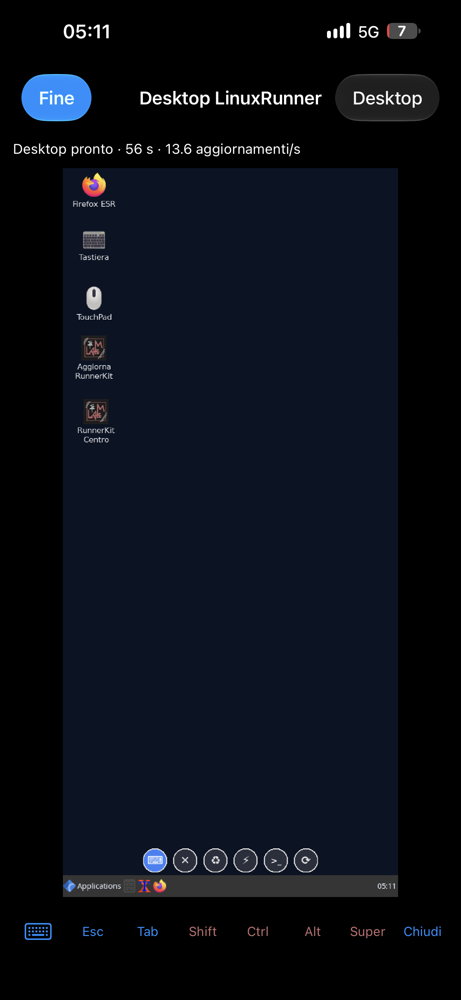
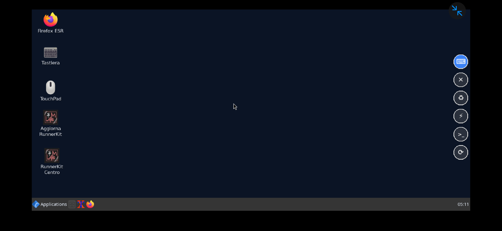
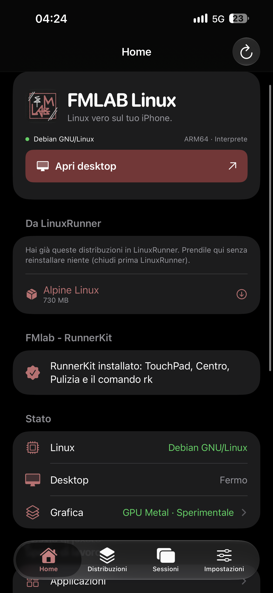
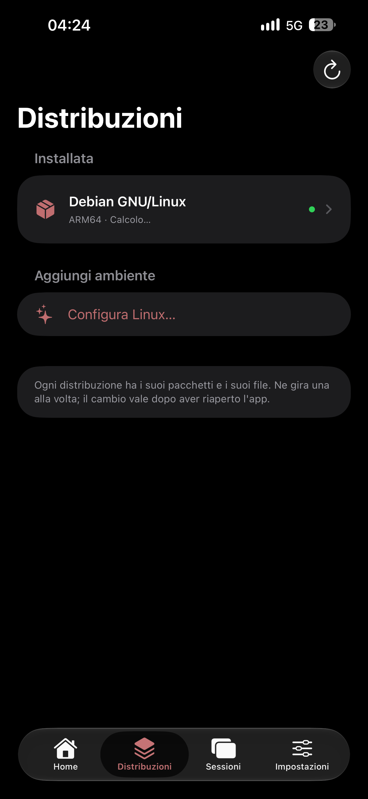
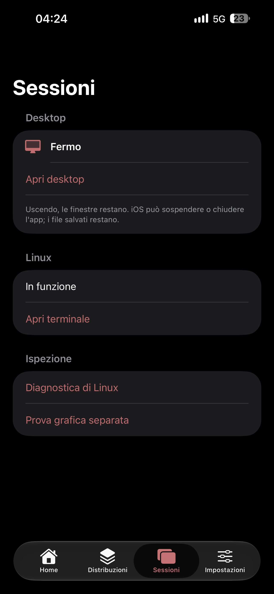
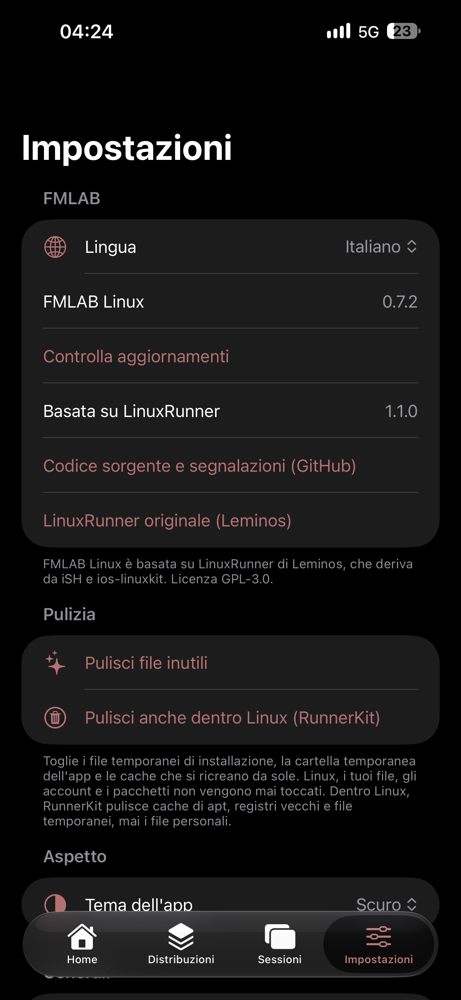

# FMLAB Linux 🐧📱

[🇮🇹 Italiano](README.md) · 🇬🇧 English

Real Linux on the iPhone (Debian GNU/Linux, Arch Linux ARM, Alpine), the FMLAB edition of
**[LinuxRunner](https://github.com/mxhm11cr/LinuxRunner)**. No jailbreak, no virtual machine: ARM64 Linux programs
run inside the app through an interpreter and a layer that translates system calls.

> **Status: 0.9.4.** LinuxRunner 1.1.0 (build 900), same engine (ARM64 interpreter, JIT, Metal GPU), with the FMLAB
> name, logo and red-and-black colours, its own identifier (`dev.fmlab.linux`, so it installs **next to**
> LinuxRunner without touching its data), in-app updates and the improvements listed below.

## Photos

Real photos from the phone (iPhone 15 Pro Max). Screenshots of the real app in the iPhone Simulator, in Italian,
refresh by themselves on every release in [docs/screenshots/ultima-versione](docs/screenshots/ultima-versione).

  
  

  
  
  
  

## Installation

LiveContainer → **+** → **Install from URL** and paste:
`https://github.com/cipherdesk007-max/fmlab-Linux-io/releases/download/ultima/FMLAB-Linux.ipa`

The app is in English by default; Settings → FMLAB → Language switches it to Italian.

## What's better than LinuxRunner

Base: LinuxRunner 1.1.0 (build 900) with the same engine (ARM64 interpreter, JIT, Metal GPU). Version history:
[CHANGELOG-FMLAB.md](CHANGELOG-FMLAB.md) (in Italian).

**App and installation**

| Improvement | Original LinuxRunner |
|---|---|
| **Installs next to the original** (`dev.fmlab.linux`): its data is never touched | One app only |
| **In-app updates**: tells you about a new version and reinstalls over itself from LiveContainer without losing anything | Download and reinstall by hand |
| **Keeps up with the original**: tells you when a newer LinuxRunner is out, and the repository opens an issue by itself | — |
| **Take everything from LinuxRunner**: distributions (instant Move or Copy) and settings (theme, terminal, mouse, graphics, desktop) | — |
| **LinuxRunner leftovers**: even after removing LinuxRunner, its remaining distributions can be taken or **deleted** to free space (e.g. Alpine, 730 MB) | They stay hidden in LiveContainer |
| **FMLAB logo, red and black colours**, the style of [FMLAB Cleaner](https://github.com/cipherdesk007-max/FMLAB-cleaner) | — |
| **Full Italian** (Settings → FMLAB → Language): 984 strings, including desktop, menus, alerts, errors and JIT states; a check on every build stops any new string from staying untranslated | English only |

**Distributions and storage**

| Improvement | Original LinuxRunner |
|---|---|
| **Native Game Emulator**: NES, Game Boy/Color, GBA, SNES, PlayStation, DS inside the app, no Linux, no JIT; on-screen controls that follow rotation and fit every iPhone and iPad, controllers and keyboards, saves, fast forward, your own game folders (iCloud too) sorted by console, *Games Only* mode; you add your own games — cores from [fmlab-retro](https://github.com/cipherdesk007-max/fmlab-retro) (0.9.0) | No emulator |
| **One-tap distribution switch from Home**: tap the one you want in *Installed Distributions*, confirm, close and reopen; it shows which one is running and which starts next (0.8.7) | You go to Distributions → distribution → Use on Next Launch |
| **Every distribution can be deleted**, even the built-in Alpine, and shows how much space it uses | Alpine is inside the app and can't be removed |
| **Cleanup** (Settings → Cleanup): installation temp files, the app's temp folder and caches, with the space freed | — |
| **Shared files**: tap a file → Save to Files / Delete, swipe to delete files and folders (safe deletion, links are never followed) | Import/export only |

**Desktop on the phone**

| Improvement | Original LinuxRunner |
|---|---|
| **Automatic, sharp "Phone" resolution**: reads the screen and divides its real pixels by a whole number (15 Pro Max: **1308×644, exactly 2×**); when the phone is hot or in Low Power Mode it uses the lighter 540-row size | 960×540 stretched, slightly blocky |
| **True full screen**: no margins and no black bars, only a strip on the camera (Dynamic Island) side, detected automatically when you rotate the phone | Black bars on every side |
| **Rotates with the phone without restarting**: landscape ↔ portrait live (RandR); windows shrink and stay inside the new screen; tested on Linux on every change | Fixed size: changing it restarts the desktop |
| **Tells RunnerKit what the screen covers** (Dynamic Island, Home indicator) and that it runs in FMLAB Linux (`/proc/ish/version`) | — |

**Fixes for bugs that were also in the original LinuxRunner**

| Bug | Now |
|---|---|
| **Terminal sometimes opening blurry** (the opening animation drew it small and the text stayed low-resolution; closing and reopening didn't always help) | Once it has opened, the text is redrawn at the screen's real resolution, without changing the shell's rows and columns (0.8.6) |
| **Shrunken desktop with black bars** on every side even in "full screen" | Fills the screen, with a strip only on the camera side (0.8.3, 0.8.5) |
| **Desktop menu, settings, alerts and errors in English only** | All translated, checked on every build (0.6.0) |

**Fixes in the port** (bugs in early FMLAB versions, already solved): the app closing when opening the Desktop menu
in Italian (0.7.1), the desktop not starting (0.8.2), the file menu appearing at the top of the screen (0.8.1).

## What RunnerKit does instead of the app

Nothing from the original LinuxRunner was removed. Some things are not in the app because
**[FMlab - RunnerKit](https://github.com/cipherdesk007-max/FMlab---RunnerKit)** does them better, inside Linux.
FMLAB Linux installs it by itself the first time Debian is ready (Home → FMlab - RunnerKit; App Manager updates or
removes it):

| What | Where |
|---|---|
| **TouchPad**: floating mouse and keyboard, buttons on the side (in a row at the bottom in portrait), always clear of the Dynamic Island, back in their corner when you rotate the phone | RunnerKit (the app's own keyboard/trackpad stay as in the original) |
| **Cleanup inside Linux** (apt cache, logs, temp files, old desktop sessions) | RunnerKit; the app runs it from Settings → Cleanup → *Clean Up Inside Linux (RunnerKit)* |
| **Performance and system Center** (RAM, CPU, disk, GPU, JIT, app), **RunnerBoost** | RunnerKit |
| **Linux in Italian** (menus, programs, Firefox, date) and keyboard following Linux's language | RunnerKit (`rk italiano`) |
| **Terminal** with a fixed status bar and `rk` commands: the bar fits the phone's width, `clear` keeps the header, no doubled lines on opening | RunnerKit |
| **Debian backup** | RunnerKit (`rk backup`) |
| **Screen rotation** | The app drives it; inside Linux it uses Python + Xlib, installed by RunnerKit (without it the screen stays fixed, as in the original) |

## How it's checked

- On every change GitHub builds the app ([build](.github/workflows/build.yml)), checks that every string is
  translated, tests rotation and session start-up on Linux ([prove-linux](.github/workflows/prove-linux.yml)), and
  photographs the real app in the iPhone Simulator, in Italian ([screenshot](.github/workflows/screenshot.yml) →
  [docs/screenshots/ultima-versione](docs/screenshots/ultima-versione)).
- **To do**: measure both apps on the same phone with the same commands (start-up, `apt install`, a Python script,
  opening the desktop, RAM used) and write the numbers here.

## How it's made

- Starting source: LinuxRunner at commit
  [`d141978`](https://github.com/mxhm11cr/LinuxRunner/commit/d141978) ("Release LinuxRunner 1.1.0 (900)").
  The original README is in [README.LinuxRunner.md](README.LinuxRunner.md), build instructions in
  [docs/BUILDING.md](docs/BUILDING.md).
- Built **for free by GitHub Actions on a Mac** ([.github/workflows/build.yml](.github/workflows/build.yml)) with
  `scripts/build-ipa.sh --unsigned`, with the JIT and the Metal GPU like the original. The Metal GPU needs heavy
  graphics dependencies (virglrenderer, libepoxy, ANGLE): the [gpu workflow](.github/workflows/gpu.yml) builds them
  once, they stay cached and go into every release.
- Fixes from the original LinuxRunner are brought in with each of its releases.

## License and credits

**GPL-3.0**, like the original: the code stays open and every change is public. See [LICENSE.md](LICENSE.md),
[LICENSE.IOS](LICENSE.IOS) and [THIRD_PARTY_NOTICES.md](THIRD_PARTY_NOTICES.md).

- **LinuxRunner** — Leminos ([mxhm11cr](https://github.com/mxhm11cr)): the real work is theirs.
- **iSH** — Theodore Dubois and contributors ([ish-app/ish](https://github.com/ish-app/ish)).
- **ios-linuxkit** — Rui Carmo and contributors ([rcarmo/ios-linuxkit](https://github.com/rcarmo/ios-linuxkit)).

Problems and ideas for FMLAB Linux: [issues](https://github.com/cipherdesk007-max/fmlab-Linux-io/issues/new).
A problem that also exists in the original LinuxRunner should be reported [to them](https://github.com/mxhm11cr/LinuxRunner/issues) too.
