# FMLAB Linux 🐧📱

🇮🇹 Italiano · [🇬🇧 English](README.en.md)

Linux vero sull'iPhone (Debian GNU/Linux, Arch Linux ARM, Alpine), versione FMLAB di
**[LinuxRunner](https://github.com/mxhm11cr/LinuxRunner)**. Niente jailbreak, niente macchina virtuale:
i programmi Linux ARM64 girano dentro l'app grazie a un interprete e a uno strato che traduce le chiamate di sistema.

> **Stato: 0.10.2.** È LinuxRunner 1.1.0 (build 900) con nome, logo e colori FMLAB (rosso e nero), identificativo
> proprio (`dev.fmlab.linux`, si installa **accanto** a LinuxRunner senza toccarne i dati), aggiornamenti dall'app
> come FMLAB Cleaner e avviso quando esce un LinuxRunner originale più nuovo. Le altre migliorie arrivano una alla
> volta, ognuna misurata contro l'originale.

## Foto

Foto vere dal telefono (iPhone 15 Pro Max). Le schermate dell'app nel simulatore iPhone, in italiano, si
aggiornano da sole a ogni versione in [docs/screenshots/ultima-versione](docs/screenshots/ultima-versione).

  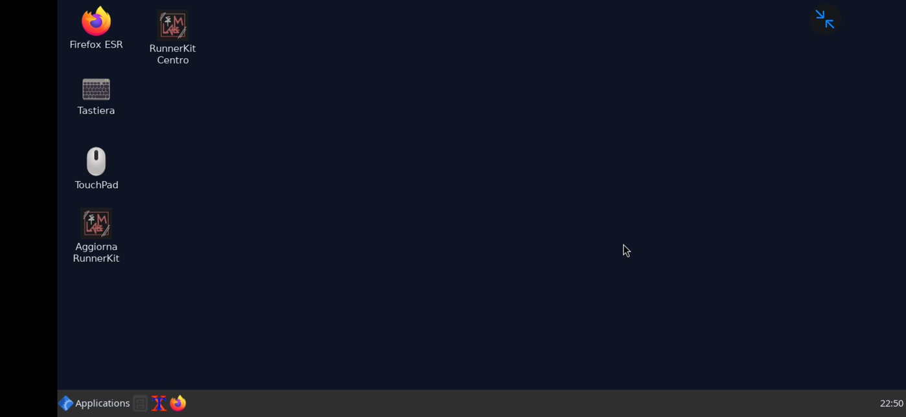

  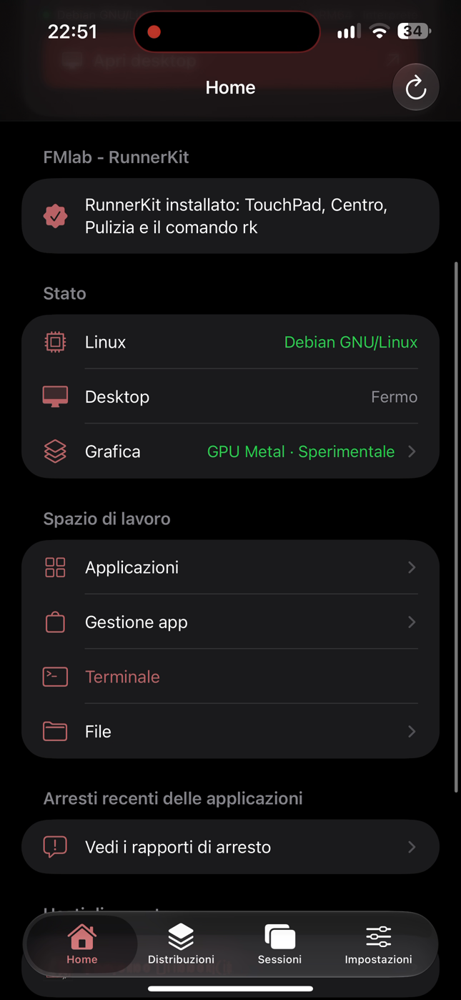
  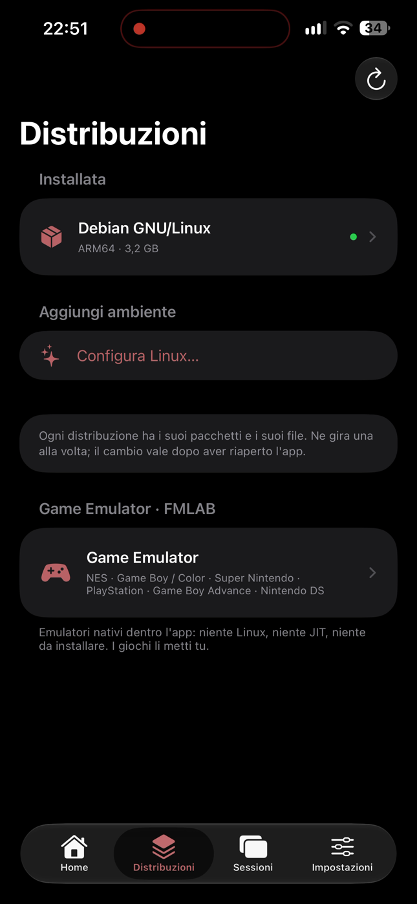
  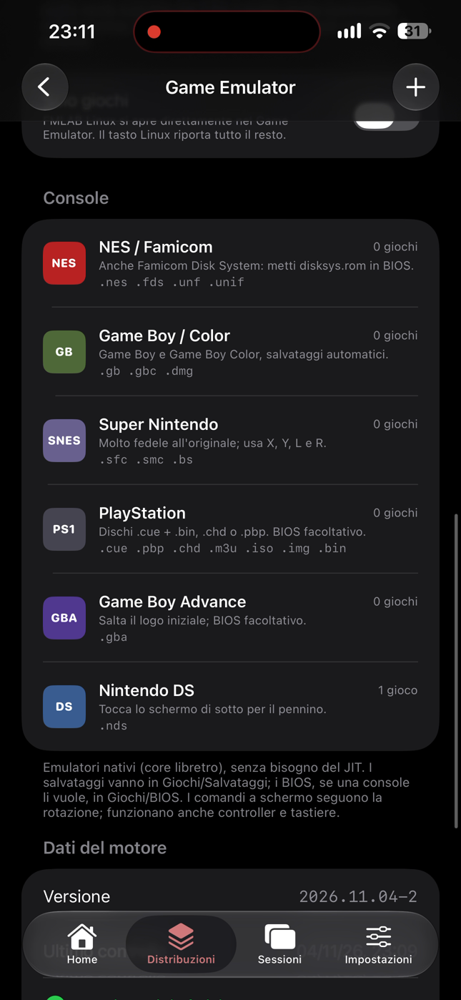
  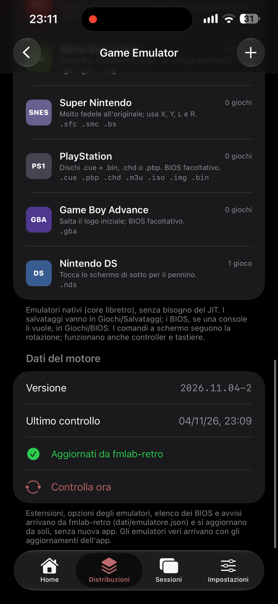

  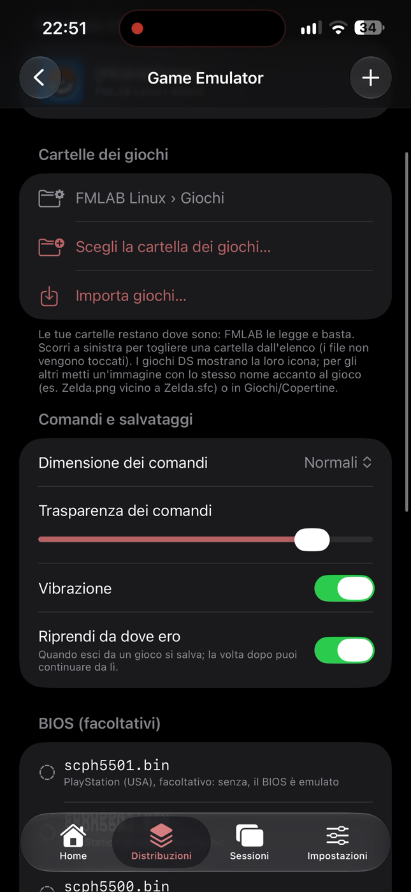

  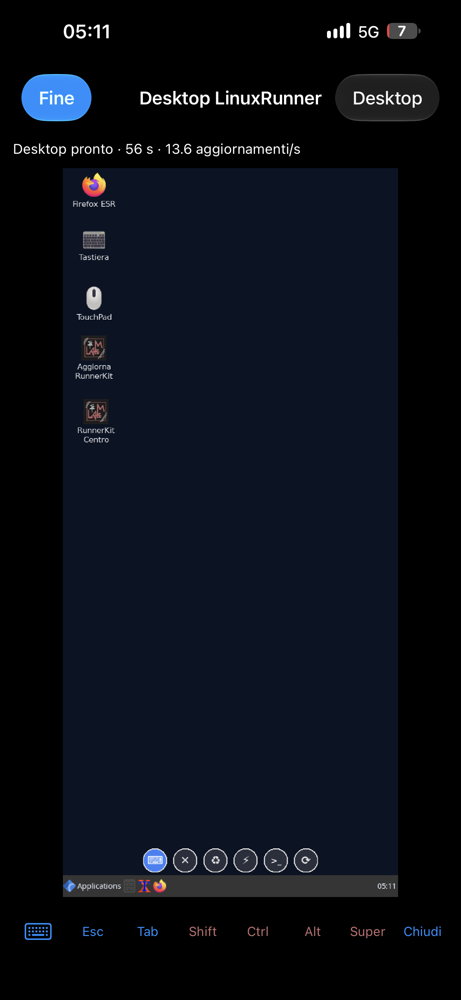
  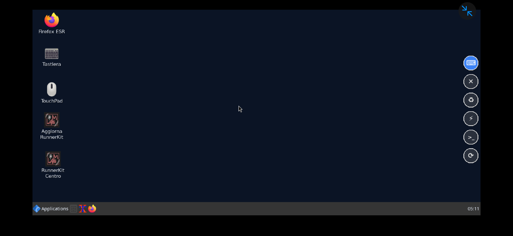

  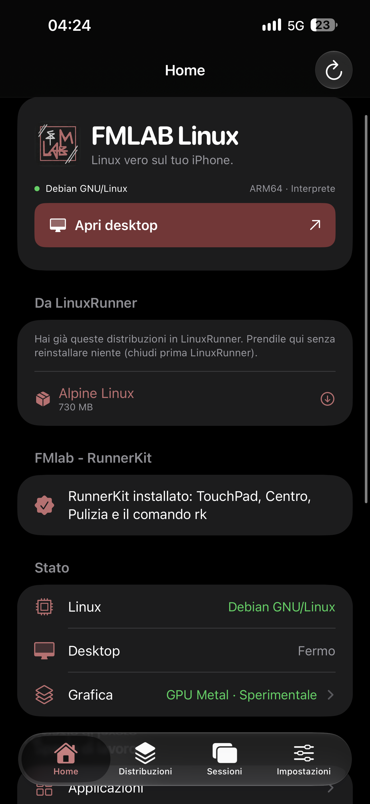
  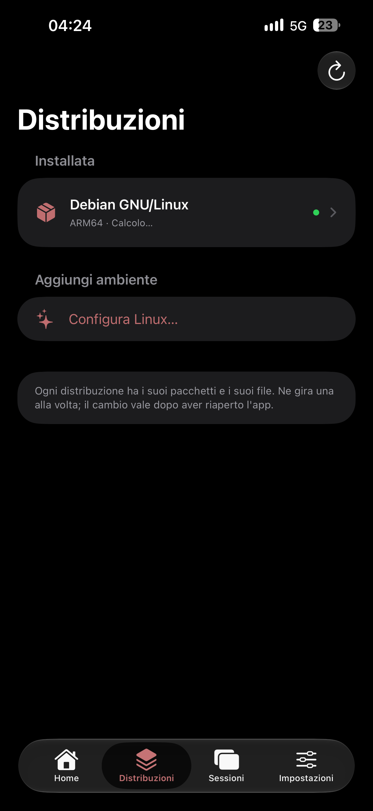
  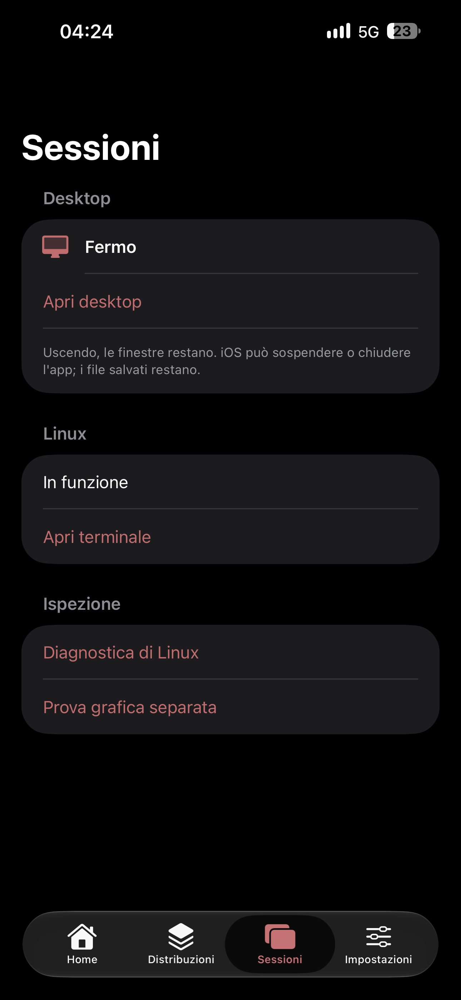
  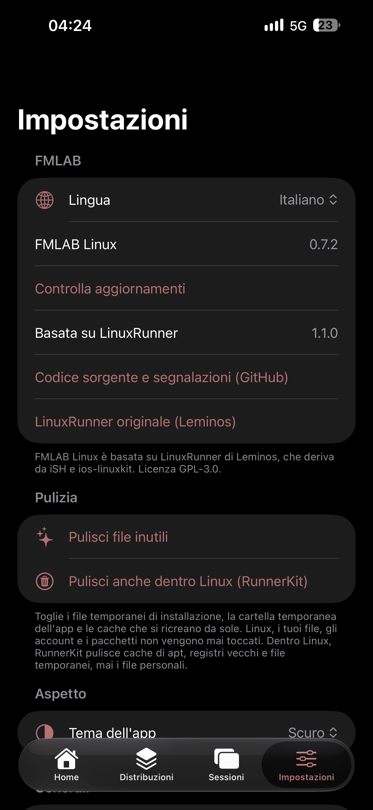

  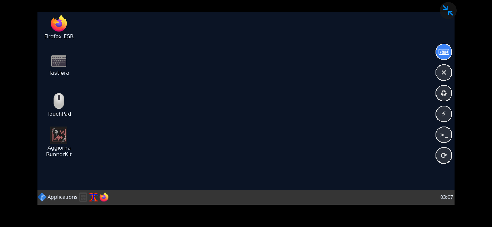

  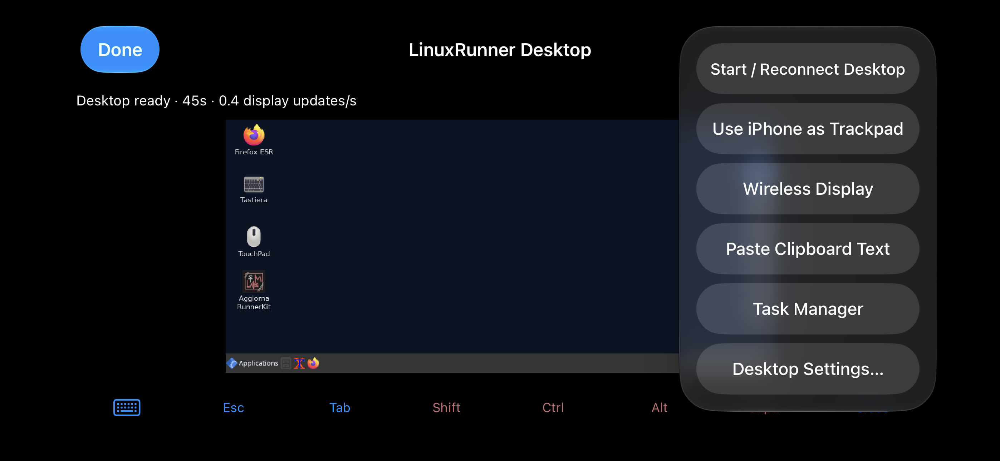

  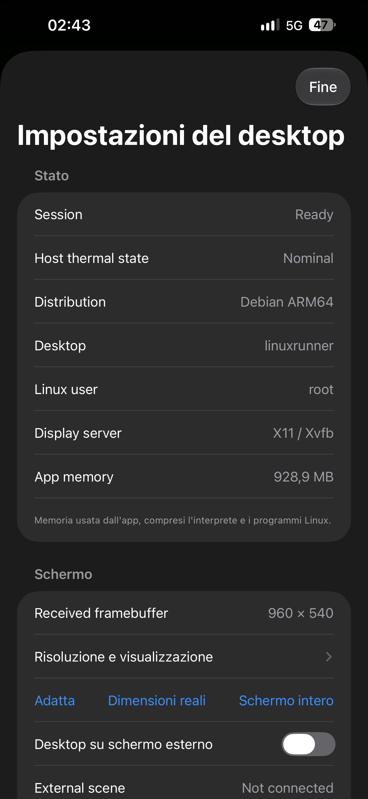
  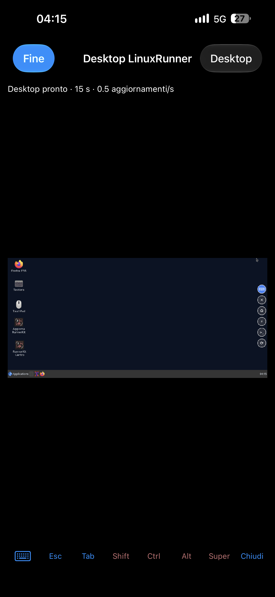
  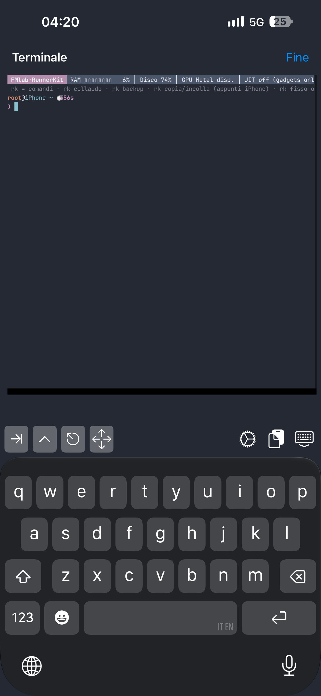

## Installazione

LiveContainer → **+** → **Installa dall'URL** e incolla:
`https://github.com/cipherdesk007-max/fmlab-Linux-io/releases/download/ultima/FMLAB-Linux.ipa`

## Cosa c'è in più rispetto a LinuxRunner

Base: LinuxRunner 1.1.0 (build 900), con lo stesso motore (interprete ARM64, JIT, GPU Metal). Le versioni sono in
[CHANGELOG-FMLAB.md](CHANGELOG-FMLAB.md).

**App e installazione**

| Miglioria | Com'è in LinuxRunner originale |
|---|---|
| **Si installa accanto all'originale** (`dev.fmlab.linux`): i suoi dati non vengono toccati | Un'app sola |
| **Aggiornamenti dall'app**: avvisa della versione nuova e si reinstalla sopra da LiveContainer senza perdere niente | Si scarica e reinstalla a mano |
| **Al passo con l'originale**: dice quando esce un LinuxRunner più nuovo e il repository apre da solo una segnalazione | — |
| **Prendi tutto da LinuxRunner**: distribuzioni (Sposta istantaneo o Copia) e impostazioni (tema, terminale, mouse, grafica, desktop) | — |
| **File rimasti di LinuxRunner**: anche dopo averlo tolto, le sue distribuzioni rimaste si prendono o si **eliminano** per liberare spazio (es. Alpine 730 MB) | Restano nascoste in LiveContainer |
| **Logo, colori rosso e nero FMLAB**, stile di [FMLAB Cleaner](https://github.com/cipherdesk007-max/FMLAB-cleaner) | — |
| **Italiano completo** (Impostazioni → FMLAB → Lingua): 984 testi, anche desktop, menu, avvisi, errori e stati del JIT; un controllo a ogni compilazione impedisce che un testo nuovo resti in inglese | Solo inglese |

**Distribuzioni e spazio**

| Miglioria | Com'è in LinuxRunner originale |
|---|---|
| **Game Emulator nativo**: NES, Game Boy/Color, GBA, SNES, PlayStation, DS dentro l'app, senza Linux e senza JIT; comandi a schermo che seguono la rotazione e si adattano a ogni iPhone e iPad, controller e tastiera, salvataggi, avanti veloce, cartelle di giochi tue (anche iCloud) divise per console, modalità *Solo giochi*, riprendi da dove eri, BIOS controllati; estensioni, opzioni e note arrivano da fmlab-retro senza nuova app; i giochi li metti tu — core da [fmlab-retro](https://github.com/cipherdesk007-max/fmlab-retro) (0.9.0) | Nessun emulatore |
| **Cambio distribuzione con un tocco dalla Home**: tocchi quella che vuoi in *Distribuzioni installate*, confermi, chiudi e riapri; si vede quale è in funzione e quale partirà al prossimo avvio (0.8.7) | Bisogna andare in Distribuzioni → distribuzione → Usa al prossimo avvio |
| **Ogni distribuzione si elimina**, anche Alpine di base, e mostra quanto occupa | Alpine è dentro l'app e non si toglie |
| **Pulizia** (Impostazioni → Pulizia): file temporanei di installazione, cartella temporanea e cache dell'app, con lo spazio liberato | — |
| **File condivisi**: tocca un file → Salva in File / Elimina, scorri per eliminare file e cartelle (eliminazione sicura, i collegamenti non vengono seguiti) | Solo importa/esporta |

**Desktop sul telefono**

| Miglioria | Com'è in LinuxRunner originale |
|---|---|
| **Risoluzione "Telefono" automatica e nitida**: legge lo schermo e divide i pixel veri per un numero intero (15 Pro Max: **1308×644, 2× esatto**); con telefono caldo o Risparmio energetico usa la misura leggera da 540 righe | 960×540 ingrandito, un po' squadrato |
| **Schermo intero vero**: niente margini e niente bande nere, solo una banda dal lato della fotocamera (Dynamic Island), riconosciuto da solo quando giri il telefono | Bande nere su tutti i lati |
| **Si gira col telefono senza riavviare**: orizzontale ↔ verticale dal vivo (RandR), le finestre si rimpiccioliscono e restano dentro lo schermo nuovo; provato su Linux a ogni modifica | Misura fissa: per cambiarla si riavvia il desktop |
| **Dice a RunnerKit cosa copre lo schermo** (Dynamic Island, indicatore Home) e che gira in FMLAB Linux (`/proc/ish/version`) | — |

**Correzioni di difetti che c'erano anche in LinuxRunner originale**

| Difetto | Com'è ora |
|---|---|
| **Terminale che a volte si apriva sfocato** (l'animazione di apertura lo disegnava piccolo e il testo restava a bassa risoluzione; chiudere e riaprire non sempre bastava) | Finita l'apertura il testo si ridisegna alla risoluzione vera dello schermo, senza cambiare righe e colonne (0.8.6) |
| **Desktop rimpicciolito con bande nere** su tutti i lati anche "a schermo intero" | Riempie lo schermo, banda solo dal lato della fotocamera (0.8.3, 0.8.5) |
| **Menu Desktop, impostazioni, avvisi ed errori solo in inglese** | Tradotti tutti, con controllo a ogni compilazione (0.6.0) |

**Correzioni dell'adattamento** (difetti delle prime versioni FMLAB, già risolti): chiusura dell'app aprendo il menu
Desktop in italiano (0.7.1), desktop che non partiva (0.8.2), menu del file che compariva in cima allo schermo (0.8.1).

## Cosa fa RunnerKit al posto dell'app

Niente di LinuxRunner originale è stato tolto. Alcune cose non sono nell'app perché le fa meglio, dentro Linux,
**[FMlab - RunnerKit](https://github.com/cipherdesk007-max/FMlab---RunnerKit)**, che FMLAB Linux installa da sola
la prima volta che Debian è pronto (Home → FMlab - RunnerKit; da Gestione app si aggiorna o si toglie):

| Cosa | Dove |
|---|---|
| **TouchPad**: mouse e tastiera fluttuanti, pallini sul lato (in fila in basso col telefono in verticale), sempre fuori dalla Dynamic Island, tornano nel loro angolo quando giri il telefono | RunnerKit (la tastiera/trackpad dell'app restano come nell'originale) |
| **Pulizia dentro Linux** (cache di apt, registri, file temporanei, sessioni vecchie del desktop) | RunnerKit; l'app la lancia da Impostazioni → Pulizia → *Pulisci anche dentro Linux* |
| **Centro prestazioni e sistema** (RAM, CPU, disco, GPU, JIT, app), **RunnerBoost** | RunnerKit |
| **Linux in italiano** (menu, programmi, Firefox, data) e tastiera secondo la lingua di Linux | RunnerKit (`rk italiano`) |
| **Terminale** con barra di stato fissa e comandi `rk`: la barra si adatta alla larghezza del telefono, `clear` non toglie il riquadro, niente righe doppie all'apertura | RunnerKit |
| **Backup del Debian** | RunnerKit (`rk backup`) |
| **Rotazione dello schermo** | L'app la comanda; dentro Linux usa Python + Xlib, che installa RunnerKit (senza, lo schermo resta fisso come nell'originale) |

## Come si verifica

- A ogni modifica GitHub compila l'app ([build](.github/workflows/build.yml)), controlla che ogni testo sia
  tradotto, prova su Linux la rotazione e l'avvio della sessione ([prove-linux](.github/workflows/prove-linux.yml))
  e fotografa l'app vera nel simulatore iPhone, in italiano ([screenshot](.github/workflows/screenshot.yml) →
  [docs/screenshots/ultima-versione](docs/screenshots/ultima-versione)).
- **Da fare**: misurare le due app sullo stesso telefono con gli stessi comandi (avvio, `apt install`, uno script
  Python, apertura del desktop, RAM usata) e scrivere qui i numeri.

## Come è fatta

- Sorgente di partenza: LinuxRunner al commit
  [`d141978`](https://github.com/mxhm11cr/LinuxRunner/commit/d141978) ("Release LinuxRunner 1.1.0 (900)").
  Il README originale è in [README.LinuxRunner.md](README.LinuxRunner.md), le istruzioni di compilazione in
  [docs/BUILDING.md](docs/BUILDING.md).
- Compilata **gratis da GitHub Actions su Mac** ([.github/workflows/build.yml](.github/workflows/build.yml)) con
  `scripts/build-ipa.sh --unsigned`, con il JIT e la GPU Metal come l'originale. La GPU Metal richiede dipendenze grafiche pesanti
  (virglrenderer, libepoxy, ANGLE): le compila una volta il [workflow "gpu"](.github/workflows/gpu.yml), restano in
  cache e da lì entrano in ogni versione.
- Le correzioni di LinuxRunner originale si riportano qui a ogni loro versione.
- Storico delle versioni FMLAB: [CHANGELOG-FMLAB.md](CHANGELOG-FMLAB.md).

## Licenza e riconoscimenti

**GPL-3.0**, come l'originale: il codice resta aperto e ogni modifica è pubblica. Vedi [LICENSE.md](LICENSE.md),
[LICENSE.IOS](LICENSE.IOS) e [THIRD_PARTY_NOTICES.md](THIRD_PARTY_NOTICES.md).

- **LinuxRunner** — Leminos ([mxhm11cr](https://github.com/mxhm11cr)): il lavoro vero è il loro.
- **iSH** — Theodore Dubois e collaboratori ([ish-app/ish](https://github.com/ish-app/ish)).
- **ios-linuxkit** — Rui Carmo e collaboratori ([rcarmo/ios-linuxkit](https://github.com/rcarmo/ios-linuxkit)).

Problemi e idee per FMLAB Linux: [segnalazioni](https://github.com/cipherdesk007-max/fmlab-Linux-io/issues/new).
Un problema che c'è anche in LinuxRunner originale va segnalato anche [a loro](https://github.com/mxhm11cr/LinuxRunner/issues).
